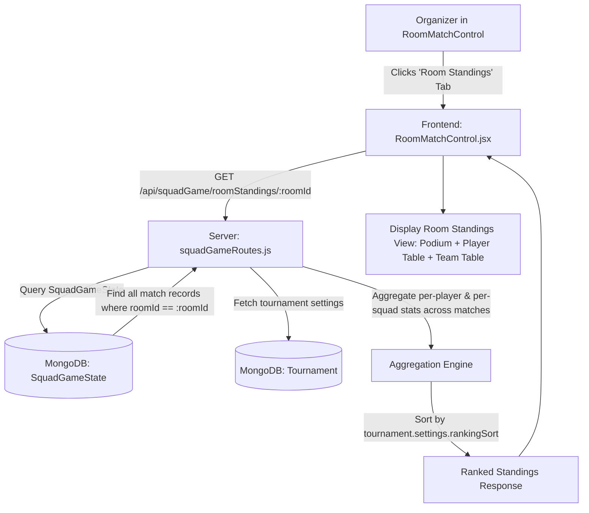

# Feature Implementation Plan: Room-Level Aggregate Rankings in Match Control

- **Date**: 2026-10-27
- **Target Room**: Room-specific match control (`/organizer/room-match/:roomId`)
- **Status**: Ready for Execution Permission

---

## 1. Feature Overview & Requirements

When matches finish in a room, organizers need an option directly inside **Room Match Control** (`RoomMatchControl.jsx`) to view aggregate rankings and standings for that specific room:

1. **Room-Isolated**:
   - Scores and statistics must be scoped strictly to the current room (`roomId`), completely separated from other rooms and tournaments.
2. **Multi-Match Aggregation**:
   - Combines scores, kills, damage, and points across all rounds/matches played in this specific room (e.g., Match 1, Match 2, Match 3...).
3. **Tournament Metric-Driven Sorting**:
   - Uses the tournament's chosen `rankingSort` rule (`'POINTS'` or `'KILLS'`) configured during tournament creation:
     - **`POINTS`**: Ranked by combined Total Points (`Total Kills × killPoints + Placement Points`). Tiebreaker 1: Total Kills desc; Tiebreaker 2: Name asc.
     - **`KILLS`**: Ranked by combined Total Kills. Tiebreaker 1: Total Points desc; Tiebreaker 2: Name asc.
4. **Individual Player & Team Standings**:
   - **Player Standings** (all modes including `SOLO`): Ranks individual players across all matches in the room (IGN, Free Fire ID, kills per match, total kills, damage, kill points, placement points, total score).
   - **Team Standings** (for `SQUAD`, `DUO`, `CLASH_SQUAD` only): Ranks teams/squads by combined team score, total kills, placement points, and Booyah counts.
   - **SOLO Mode**: Only the Player Standings table is shown (no Team Standings). Each solo player is ranked individually by combining kills/points across all matches in the room. The podium displays the top 3 individual players.
5. **Seamless Control UX**:
   - Adds an **"🏆 Room Standings"** tab button alongside match switcher tabs (`#1`, `#2`, etc.) in `RoomMatchControl.jsx`.
   - When a match is completed, displays an actionable banner prompting the organizer to view the combined room standings.
   - Includes a one-click **"Copy Standings"** action to format and copy the room leaderboard for posting to WhatsApp or Discord.

---

## 2. Architecture & Data Flow



### Mathematical Formulas & Rules
- `totalKills = Sum(player.kills across all completed match states for roomId)`
- `killPoints = totalKills * (tournament.settings.killPoints || 1)`
- `placementPoints = Sum(squadPlacementPoints across matches)`
- `totalPoints = killPoints + placementPoints`
- Per-match map: `matches: { [matchNumber]: kills }`

---

## 3. Detailed Component & API Design

### 3.1 Backend Endpoint: `GET /api/squadGame/roomStandings/:roomId`
**Location**: `server/routes/squadGameRoutes.js`

#### Endpoint Logic:
1. **Find Room & Tournament**:
   - Find `Room` by `roomId`. Return 404 if not found.
   - Find `Tournament` by `room.tournamentId`.
   - Extract `tournament.settings.rankingSort` (defaults to `'POINTS'`) and `tournament.settings.killPoints` (defaults to 1).
2. **Fetch Game States**:
   - Query all `SquadGameState` documents with `{ roomId: room._id }`.
   - If no records exist by `roomId`, fall back to finding by `squadId` in `room.squads / room.duos / room.players` to ensure backward compatibility.
3. **Aggregate Player Rankings**:
   - Group by unique `ffId`.
   - Track `playerName`, `ffName`, `teamName`, `matchesPlayed`, `matchBreakdown: { 1: kills, 2: kills }`, `totalKills`, `totalDamage`, `killPoints`, `placementPoints`, `totalPoints`.
   - Sort using comparator matching `rankingSort`.
   - Assign sequential rank: `1, 2, 3...`.
4. **Aggregate Team Rankings** (for `SQUAD`, `DUO`, `CLASH_SQUAD` — skip for `SOLO`):
   - Group by `squadId`.
   - Track `squadName`, `matchesPlayed`, `booyahs` (placement === 1 count), `totalKills`, `placementPoints`, `totalPoints`, `players: [...]`.
   - Sort using comparator matching `rankingSort`.
   - Assign team rank: `1, 2, 3...`.
   - **SOLO mode**: `teamRankings` array is returned empty `[]`. The Player Rankings table is the primary (and only) standings view.
5. **Response Payload**:
   ```json
   {
     "success": true,
     "roomId": "...",
     "roomName": "Room 1",
     "mode": "SQUAD",
     "rankingMetric": "POINTS",
     "killPointsMultiplier": 1,
     "totalMatchesPlayed": 2,
     "playedMatchNumbers": [1, 2],
     "playerRankings": [
       {
         "rank": 1,
         "playerName": "Shadow",
         "ffName": "SHADOW_07",
         "ffId": "10029384",
         "teamName": "Ghost Squad",
         "matchesPlayed": 2,
         "matchBreakdown": { "1": 4, "2": 5 },
         "totalKills": 9,
         "killPoints": 9,
         "placementPoints": 21,
         "totalPoints": 30
       }
     ],
     "teamRankings": [
       {
         "rank": 1,
         "squadName": "Ghost Squad",
         "matchesPlayed": 2,
         "booyahs": 1,
         "totalKills": 16,
         "placementPoints": 21,
         "totalPoints": 37
       }
     ]
   }
   ```

---

### 3.2 Frontend UI in `RoomMatchControl.jsx`
**Location**: `client/src/pages/organizer/RoomMatchControl.jsx`

#### UI Elements:
1. **Standings Tab in Navigation Header**:
   - Right next to the match tabs (`#1`, `#2`, `#3`), add:
     ```jsx
     <button
       onClick={() => setViewMode('STANDINGS')}
       className="px-3 py-1 text-sm font-bold font-oswald uppercase tracking-wider flex items-center gap-1.5"
     >
       <Trophy className="w-3.5 h-3.5 text-yellow-400" /> Standings
     </button>
     ```
2. **Match Completed Banner Prompt**:
   - When viewing a completed match:
     ```
     [🏆 Match Complete | View Combined Room Standings]
     ```
3. **Standings Screen Features**:
   - **Metric Indicator Badge**:
     `RANKING METRIC: TOTAL POINTS` (or `TOTAL KILLS`) with kill points multiplier.
   - **Podium Cards**: Top 3 Gold (#1), Silver (#2), Bronze (#3) cards.
   - **Player Standings Table**:
     - Columns: Rank, Player / FF IGN, FF ID, Team, Matches, Match 1 Kills, Match 2 Kills..., Total Kills, Kill Pts, Placement Pts, Total Score.
   - **Team Standings Table** (in Team / Clash Squad modes):
     - Columns: Rank, Team Name, Matches, Booyahs, Total Kills, Placement Pts, Total Score.
   - **Copy Standings Button**: Formats results to clipboard for quick sharing on tournament WhatsApp groups and Discord.

---

## 4. Step-by-Step Implementation Checklist

- [ ] **Step 1: Backend Route**:
  - Add `GET /api/squadGame/roomStandings/:roomId` in `server/routes/squadGameRoutes.js`.
  - Implement aggregation of players and squads across all matches in `roomId`.
  - Apply `tournament.settings.rankingSort` (`POINTS` vs `KILLS`) sorting and tie-breaking.
- [ ] **Step 2: Frontend State & Tab in `RoomMatchControl.jsx`**:
  - Add `viewMode` state (`'MATCH'` vs `'STANDINGS'`).
  - Add `roomStandings` state and `fetchRoomStandings` function.
  - Add "Standings" tab to the header alongside match switcher tabs.
- [ ] **Step 3: Frontend Standings Display Component**:
  - Render podium for Top 3.
  - Render Individual Players table with per-match breakdown and metric points.
  - Render Team standings table (for team modes).
  - Add "Copy Standings" button for WhatsApp/Discord sharing.
- [ ] **Step 4: End-to-End Verification**:
  - Test with a tournament using `POINTS`.
  - Test with a tournament using `KILLS`.
  - Test room isolation (ensuring standings only include participants from the active room).
  - Test in `SOLO`, `DUO`, `SQUAD`, and `CLASH_SQUAD` modes.
